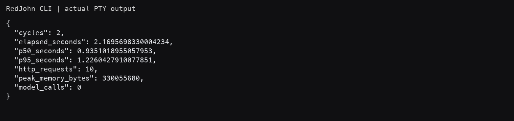
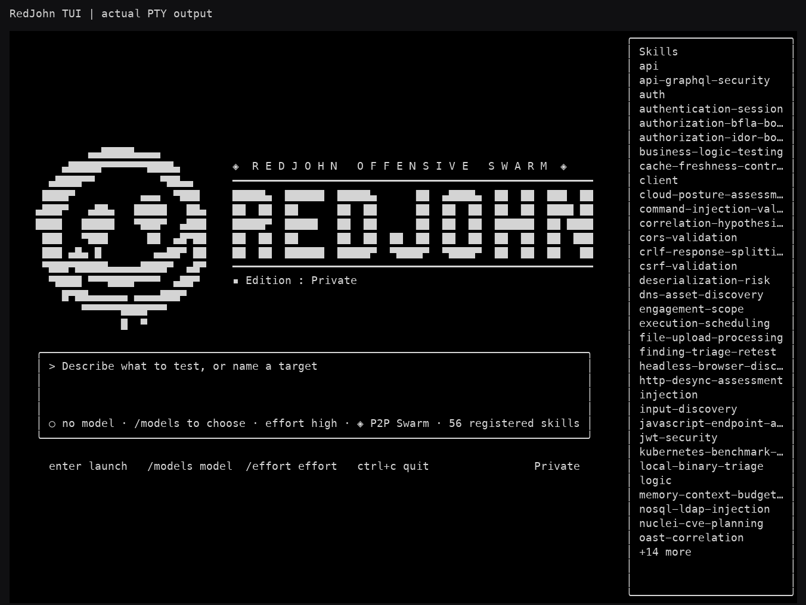
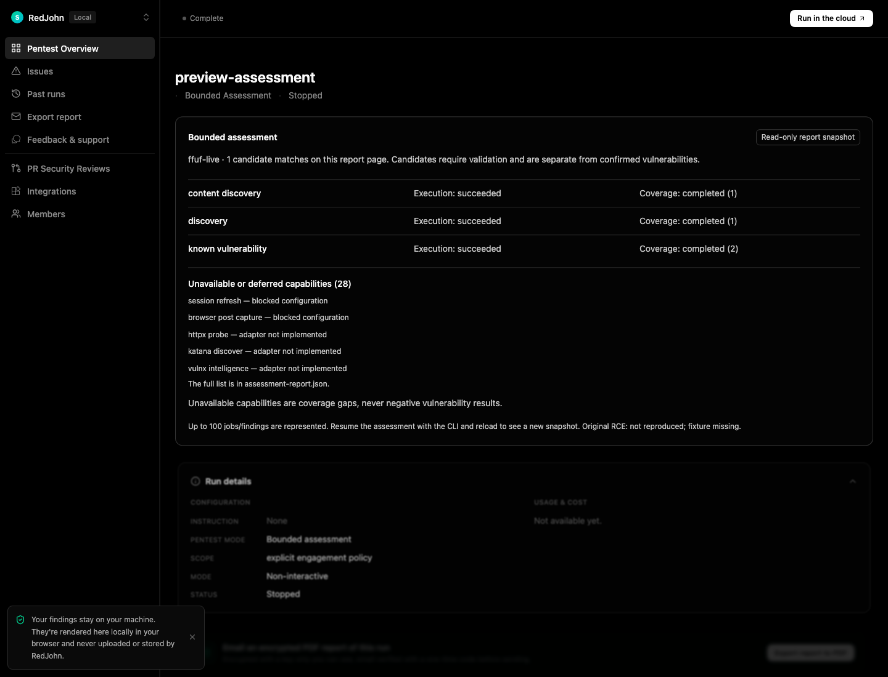

# RedJohn — ffuf, assessment Web View és valódi E2E

2026-10-17. A teljes, 675 soros master prompt újra elolvasva. Ellenőrzött origin:
`https://github.com/akosdrx/redjohn.git`. Ez új, működő vertikális szelet;
**nem a teljes master prompt elkészültének állítása**.

## Implementáció

- `assessment/ffuf.py`: explicit, SHA-pinnelt ffuf 2.1.0; maximum 64 jóváhagyott
  relatív útvonal; anonymous GET; tartós scheduler, fair tervező, közös request
  budget/cooldown és scanner lease. Nincs automatikus telepítés, recursion,
  redirectkövetés, tetszőleges flags/config/wordlist, POST vagy auth fallback.
- A meglévő proxy és bounded supervisor újrahasznosul. A host ellenőrzi a cél
  TLS-láncát/SAN-ját/SNI-jét, a pontos URL-t, DNS/IP scope-ot és a teljes választ.
  Távoli módban ténylegesen attesztált Linux namespace és privát relay szükséges.
  Az upstream ffuf saját TLS-bypassát nem tekintjük védelmi határnak.
- A proxy az új adapternél még továbbítás előtt elutasítja a tömörített választ:
  ffuf nem tud korlátlan gzip/brotli/deflate kibontást végezni. A wire limit 1 MiB,
  stdout/stderr külön 128 KiB; deadline, process-group cancel és cleanup él.
- Csak JSON-eredménnyel egyező, teljes host-válasz kerül observed inventoryba.
  A 404 kontroll bizonyíték marad; a felderítés önmagában nem finding.
- A bináris és a jóváhagyott input változata része a tartós jobazonosságnak.
  Pusztán rate/timeout módosítása nem ismétli meg a kész próbát. Explicit
  retest vagy releváns input/tool/policy-változás új munkát enged.
- A valódi cancel-teszt feltárta, hogy a meglévő store eldobta a részleges
  evidence-hivatkozásokat. A javítás kizárólag az adott engagement/job már
  elmentett referenciáit tartja meg; findingállítás nem él túl egy cancelt.
- A riport a futás konfigurált capability registryjét használja. Az új
  `view --assessment-dir` a nyilvános report legfeljebb 1 MiB-os pillanatképét
  olvassa. A candidate, execution, coverage és capability gap külön látszik.
  Nyers evidence, vault és privát SQLite nem kerül a Web View olvasójába.
  A módosító scan/steer végpontok a szerver teljes élettartamára tiltottak,
  a riport későbbi eltűnésekor is. A régi run formátum megmaradt.
- A TUI három beégetett „170” feliratát a tényleges registry darabszáma váltotta
  fel, opcionális, visszafelé kompatibilis snapshotmezővel. Jelenleg 47 assessment
  és 9 domain leírás, összesen 56 regisztrált skill van. Ez nem live tool coverage.
  Az angol inventory-skill új ffuf mappinget kapott; az eredeti provenance megmarad.

## Lefuttatott ellenőrzések

A teljes csomag unit/kontraktus-, mock- és valódi integrációs teszteket is tartalmaz;
**nem mind a 704 eset valódi scannerfuttatás**. Az új négy aktív tesztfájl 40 esetet
ad: 29 input/health/report kontraktus vagy projekció, 11 valódi bináris-/browser-
integráció. A teszt sosem telepít magától motort vagy fake engine-t.

| Ellenőrzés | Tényleges eredmény |
|---|---|
| macOS ARM64, teljes pytest | **689 passed, 15 skipped**, 120,55 s |
| Izolált Ubuntu/Linux ARM64, teljes pytest | **704 passed, 0 skipped**, 196,48 s |
| Teljes strict mypy, macOS és Linux | **0 hiba, 188 forrásmodul** |
| Ruff, teljes Python-forrás/scripts/tests | sikeres |
| Módosított Python-fájlok formázása | sikeres |
| Viewer production build | **2261 modul, 2,62 s** |
| TypeScript `--noEmit --noUnusedLocals --noUnusedParameters` | sikeres |
| Go TUI `go test ./...`, `go vet ./...` | sikeres; négy csomag fordul, Go unit-tesztfájl nincs |
| Web View | valódi Chromium, valódi HTTP-cookie/token jogosultság, 1440 és 375 px, reduced motion |

A 15 macOS-kihagyás Linux kernel-egresshez kötött eset, köztük az új ffuf remote
lánc. **Mind lefutott és sikeres lett Linuxon.** A Chromium sandbox és az upstream
TLS-ellenőrzés nincs általánosan kikapcsolva. A Viewer meglévő 500 kB feletti
bundle-warningja megmaradt; ez nem TypeScript- vagy buildhiba.

Bizonyíték: [macOS JUnit](measurements/ffuf-discovery/mac-tests.junit.xml),
[Linux JUnit](measurements/ffuf-discovery/linux/linux-tests.junit.xml),
[gépi összesítés](measurements/ffuf-discovery/verification-summary.json),
[mypy macOS](measurements/ffuf-discovery/mypy-macos.txt),
[mypy Linux](measurements/ffuf-discovery/linux/mypy-linux.txt).
Az összes vendégbe adott 377 fájl hash-e egyezett a futás előtt és után is.

## Valódi mérések

A saját HTTPS-fixture-t járja be a Chromium; az ffuf által ténylegesen megfigyelt
inventory-rekordot használja a Nuclei. A controller/store minden szakasz közt
újranyílik. Utána javított marker-kontroll és ismételt submit következik.

| Lánc | Teljes idő | HTTPS-kérések | Nuclei marker candidate / javított kontroll | Modellhívás |
|---|---:|---:|---:|---:|
| macOS loopback | 2,554 s | 6 | 1 / 0 | 0 |
| Linux loopback | 2,045 s | 6 | 1 / 0 | 0 |
| Linux non-loopback, kernelhatárral | 2,537 s | 6 | 1 / 0 | 0 |

A remote láncban az ffuf 0,816 s, a két Nuclei job 0,461 és 0,448 s volt.
Négy job mediánja 0,565 s; nearest-rank p95 0,816 s, **csak négy minta**.
Az ismételt submit/reopen és a külön CLI QoS-váltás **0 új/duplikált kérést** ad;
az explicit retest viszont ténylegesen újra fut. A 404 útvonal nincs a felfedezett
endpointok között, a redirect célját nem követi a rendszer.

Linuxon a böngészős szakasz `partial`: a proxy a Chromium beépített, scope-on
kívüli kapcsolódási próbáit blokkolta. Az előírt oldal és readiness lefutott;
az ffuf és a Nuclei szakaszok `completed`. Ezt nem nevezzük teljes böngészős
lefedettségnek, és az allowlistet nem tágítottuk ki.

A megőrzött automatikus refresh → új capture → Nuclei lánc hét valódi Linux
esete is újrafutott: **57 HTTPS-kérés, 6 refresh, 15 marker candidate, 0 duplikáció,
0 modellhívás**, összesített futási idő 28,040 s. A workerlease maximuma 1,
browser/scanner átfedési minta 0. A 25 ms célidővel gyűjtött 1110 process-tree
RSS-minta maximuma **1 071 620 096 B (1021,98 MiB)**; a legnagyobb mintaköz
69,23 ms. Megosztott memórialapok többször számolódhatnak, a mintavétel kihagyhat
rövid csúcsot; ez nem hard OS-memórialimit. Az új ffuf-lánc admission-mintáinak
legnagyobb RSS-e 817 696 768 B; ez sem folyamatos ffuf-processzprofil.

Valódi hibainjektálás: hibás upstream TLS, gzip, 429/cooldown, budgetkimerülés,
bináris-hash eltérés, timeout és explicit cancel. Mind hiba/blocked/inconclusive
eredményt és cleanupot ad; egyik sem sikeres negatív sérülékenységvizsgálat.
A régi POST/JSON/form/multipart/body-token/session és egress E2E-k is a teljes
Linux-csomag részei. [Nyers mérési rekordok](measurements/ffuf-discovery/linux/).

Az ártalmatlan marker **pipeline-ellenőrzés**, nem RCE-bizonyíték. Régi/új,
azonos workloadú teljesítménybaseline nincs: `baseline_unavailable`; gyorsulási
százalékot és általános false-negative garanciát nem állítunk.

## Megőrzés és forrás

Mind az **54 korábbi aktív teszt/segédfájl byte szerint változatlan**, négy új
aktív fájl került melléjük. A master prompt, Git HEAD/index és a saját MCP-config
hash-e megmaradt; nincs reset, clean, commit vagy push. A nagy, örökölt Git
átstrukturálás nem feladati törlés. A Nuclei, auth/session, natív CVE-, általános
MCP- és providerintegrációk helyben megmaradtak; külső, credentiales szolgáltatások
élő működését a lokális tesztcsomag önmagában nem bizonyítja.

[Megőrzési rekord](measurements/ffuf-discovery/preservation.json),
[szakasz fájlmanifestje](redjohn-ffuf-changed-files.json),
[összesített aktuális fájllista](redjohn-changed-files.json).
A Viewer generált bundle-je a megőrzött forrásokból újraépült; a korábbi bundle
visszaállítható másolata a takarítási rekordban szerepel. Aktív tesztet vagy saját
eszközt nem töröltünk.

[Takarítás és visszaállítható helyek](measurements/ffuf-discovery/cleanup.json),
[VM-izoláció és ellenőrzött törlés](measurements/ffuf-discovery/vm-isolation-and-deletion.json),
[a 15 macOS-kihagyás Linux-eredménye](measurements/ffuf-discovery/macos-skip-resolution.json).
Az ideiglenes VM és adatai megszűntek; a vendégben a takarítás ellenőrzésekor
nem maradt ffuf/Nuclei/bwrap/Chromium worker. A szükséges helyi managed binárisok
és az aktív regressziós/E2E-tesztek megmaradtak.

ffuf: hivatalos 2.1.0, commit `7a2756a8f367c69c261544ae83d52e86b1ca52d0`, MIT;
Linux ARM64 executable SHA-256
`63ef267bef305eba63d9234dfe1c486be2d48c72d63edc733937ed1014cfb70f`.
[Hivatalos release](https://github.com/ffuf/ffuf/releases/tag/v2.1.0),
[macOS telepítési receipt](measurements/ffuf-discovery/ffuf-install-macos.json),
[Linux receipt](measurements/ffuf-discovery/linux/ffuf-install.json).
Archive/checksum/licenc pin ellenőrzött; független aláírás-hitelesítés nincs állítva.
A meglévő Nuclei 3.11.1 és a külön lockolt saját marker-bundle maradt használatban.
Nincs átvett upstream Strix/HexStrike kód és nincs Firecrawl.

## Indítás és reprodukció

[Részletes angol runbook és konfiguráció](ffuf-discovery.md),
[titokmentes, kitöltendő példa](../examples/assessment-ffuf.json).
A parancsok a repository gyökeréből futnak.

```sh
PYTHONPATH=. .venv/bin/redjohn assess demo --cycles 2 --output redjohn_runs/demo
PYTHONPATH=. .venv/bin/redjohn assess run --config /absolute/approved.json --output redjohn_runs/approved
PYTHONPATH=. .venv/bin/redjohn view --assessment-dir redjohn_runs/approved --no-open

PYTHONPATH=. REDJOHN_TELEMETRY=0 OPENAI_AGENTS_DISABLE_TRACING=1 \
  REDJOHN_REQUIRE_FFUF_E2E=1 .venv/bin/python -m pytest tests -q
.venv/bin/python -m mypy redjohn --no-incremental
```

Linuxon az előkészített kernel/bwrap környezetben `REDJOHN_REQUIRE_REMOTE_E2E=1`
kötelezővé teszi a remote eseteket is. A CI explicit pinned telepítési lépést és
kötelező ffuf E2E-t kapott. **GitHub CI-t nem futtattunk**; helyben, saját izolált
Ubuntu VM-ben mértünk. A VM nem kapott host mountot vagy SSH-agentet.

## Külön jelölt hiányok és blokkolások

- `adapter_not_implemented`: httpx, Katana, VulnX és a capability-mátrix többi
  hiányzó specialista-adaptere. A jelenlévő régi natív CVE-eszköz ettől külön marad.
- `blocked`: távoli worker megfelelő Linux namespace/bwrap nélkül; hiányzó pin,
  provider/vault/credential vagy a policy által nem engedélyezett cél/művelet.
  Ez nem negatív finding. A privát, éles login/MFA és külső fiókok nincsenek igazolva.
- ffufnál `unsupported_input`: auth/POST/body, query/vhost fuzzing és tetszőleges
  scanneropció. Tömörített válasz feldolgozása külön hibakód és inconclusive coverage.
- Részleges: régi agent/TUI/MCP teljes governed-migráció, élő scheduler-vezérlés
  a Web View-ból, hostglobális több-adatbázisos admission és hard OS-RAM-limit.
- Nincs Kali release-/csomagteszt, hosszú soak vagy teljes CVE-template-katalógus
  igazolás. Az eredeti RCE: `not_reproduced_missing_fixture`.

## Képek

A CLI és TUI képe **valódi PTY-kimenetből renderelt kép**, nem natív macOS
ablakkép: a natív Terminal-capture-t az app eszközkorlátja tiltotta.
A TUI tényleges Go/Python IPC-vel induló setupképernyő, providerkapcsolat és scan
nélkül. A Web View valódi headless Chromium-kép, valódi E2E-riporttal. Nem mockupok.
Capture-receiptek és szöveges terminálképek a mérési mappában vannak.




